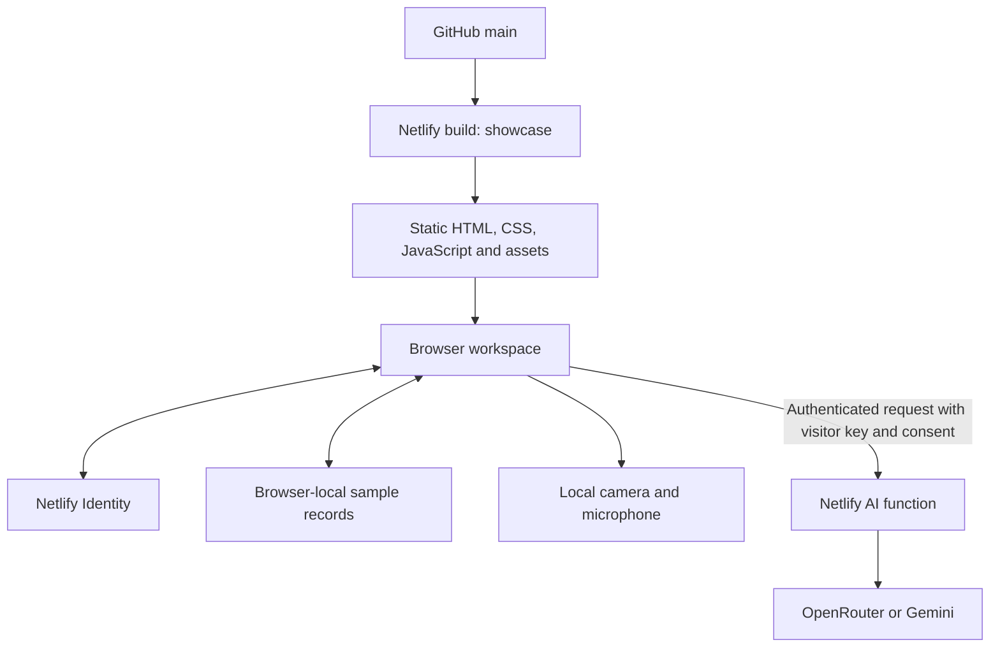

# Current architecture

The live FireCam app is built from `showcase/`. Earlier backend prototypes are retained for reference and are not production dependencies.

## Source responsibilities

| Source | Responsibility |
| --- | --- |
| `showcase/src/app.js` | Public pages, routing, accounts and workspace interactions |
| `showcase/src/model.js` | Sample devices, scenarios, state validation and CSV export |
| `showcase/src/detector.js` | Experimental pixel and motion checks |
| `showcase/src/media.js` | Camera/microphone capture, image preparation and cleanup |
| `showcase/netlify/handler.mjs` | Method, origin, content type, login and request-size checks |
| `showcase/netlify/providers.mjs` | Provider discovery, consent/billing validation and image review |
| `showcase/netlify/functions/ai.mjs` | Netlify entry point; six requests per 60 seconds, aggregated by domain/IP |
| `showcase/scripts/build.mjs` | Copy assets and bundle browser JavaScript with esbuild |

## Storage and trust boundaries

Netlify Identity stores accounts. Sample records use the `firecam-showcase-v1` localStorage key. They are shared by people using the same browser profile, do not sync between devices, and must not contain sensitive personal information. The client-side dashboard gate protects navigation, not private server data.

The AI function independently requires a signed-in user and same-origin JSON requests. It limits request size, validates models and consent, and avoids returning raw provider errors. Requests carry the visitor's own provider key; no key is embedded in the bundle. Images are transmitted only after the explicit review action. Provider processing and billing policies apply.

Microphone recordings and prepared snapshots stay in memory. Media capture stops on relevant navigation/lifecycle events. Local image rules are a heuristic experiment, not a validated fire detector. Scenario assessments are deterministic sample text and never call the AI provider.

## Historical code

The root Node/SQLite server, Worker/D1 implementation, PostgreSQL modules and migrations, legacy GitHub data adapter, and older API/interface tests document prior approaches. They are not executed by the current npm commands or Netlify build. Some require assets/configuration no longer included, so they are not supported alternate startup paths.

There is no PWA manifest or offline service worker in the active showcase. `docs/sw.js` only retires the previous GitHub Pages service worker. Earlier PWA, database and ChatGPT/Firebase authentication claims do not apply to this release.
